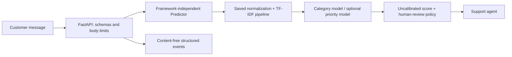
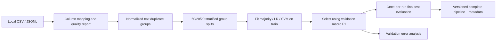

# Intelligent Support Ticket System

A CPU-only, end-to-end NLP application for assisting support agents with ticket categorization and **optional, independently trained priority classification**. Includes data quality reports, leakage-aware splits, model comparison, artifact management, inference, FastAPI, automated tests, CI, and container configuration.

**Status:** local synthetic-data integration verified, not production validated. No real support-ticket dataset was supplied. No customer adoption, cloud deployment, calibrated confidence, or real-world performance is claimed. Predictions must not trigger refunds, account/security changes, or other irreversible actions.

## Architecture





### Why this design?

Word TF-IDF captures phrases; character n-grams handle spelling variations and technical fragments. Logistic Regression is a fast, interpretable probability-producing baseline; its probabilities are **not established as calibrated**. Linear SVM supplies a strong sparse-text comparison but no probability is invented for it. A majority classifier establishes a meaningful floor. No GPU, LLM, Transformer download, database, or distributed service is required. See [engineering guide](docs/ENGINEERING.md) for concepts, failure modes, verification, and interview questions at every stage.

## Repository structure

```text
configs/config.example.yaml   Strict, reproducible configuration
src/support_ticket/
  config.py                  YAML/Pydantic configuration
  cli.py                     Data and experiment workflows
  data/                      Loading, validation, grouping, plots, synthetic fixture
  features/text.py           Shared serializable normalization
  models/                    Training, metrics/errors, artifact IO, prediction
  api/                       FastAPI, strict schemas, logging configuration
 tests/                      Offline synthetic unit/integration tests
 reports/                    Executed synthetic sample reports and figures
 docs/                       Educational and operational guides
 models/                     Ignored model artifacts
 requirements.lock           Fully pinned local environment (including dev/build tools)
 Dockerfile                  Non-root API image; artifacts mounted separately
 .github/workflows/ci.yml     Tests, lint, CLI integration, container smoke check
```

## Data source, license, and assumptions

The repository originally contained only its existing MIT `LICENSE`; that file is unchanged. **The code license does not license third-party data.**

Candidate source: [Kaggle customer support ticket dataset](https://www.kaggle.com/datasets/suraj520/customer-support-ticket-dataset). Kaggle is outside this environment's permitted network hosts. Its current license, file structure, content, label semantics, and provenance **have not been verified**. No claim is made that it contains valid category or priority ground truth. No Kaggle dataset is downloaded or redistributed here.

Before using it (or another public source):
1. Obtain the source through its official page, review its current license and terms for intended use, inspect any synthetic provenance, and record URL, revision/date, license, and SHA-256 locally.
2. Download manually into `data/raw/` (ignored), never into source control. Verify privacy/retention permissions. Review sample records locally, without copying customer content to issues/logs.
3. Inspect actual columns and label definitions. Set the source-to-canonical mappings in a **new** config, update `dataset_id`, `source_license`, and `synthetic`. Use `synthetic: false` only when the source really is genuine data.
4. Set explicit label allowlists and only semantically defensible mappings. Do not map ticket status, resolution, or sentiment to urgency or assume the example business categories exist.
5. Validate, audit repeated templates and label conflicts, then train. Priority remains disabled until suitable labels and `priority_labels_verified: true` are explicitly supplied.

### Canonical contract

| Field | Requirement |
|---|---|
| `ticket_id` | Required nonempty unique string; derive a stable ID upstream if absent |
| `ticket_text` | Required nonempty string, at most configured characters |
| `category` | Required string label; optional explicit mapping/allowlist |
| `priority` | Optional; required nonempty string when priority enabled |
| `created_at` | Optional retained metadata, not a feature; timestamp parsing/temporal splitting is not implemented |

Only mapped columns are retained; unrelated customer metadata is excluded. CSV is loaded as strings (including numeric IDs); JSONL keeps source types and rejects non-string required values. Source files must fit in memory. No automatic dropping, imputation, or label repair occurs. Validation failures produce a report and exit code 2 before fitting. Exact record duplicates are counted over mapped columns. Duplicate text and normalized-text groups are reported separately. Repeated IDs and conflicting group labels require manual reconciliation. Legitimate independent duplicate messages with different IDs are retained in the same split.

## Installation

Verified on Linux x86-64 with Python **3.11.2**. Package permits Python 3.11–3.12; only 3.11 was executed here. No GPU needed.

```bash
python3.11 -m venv .venv
source .venv/bin/activate
python -m pip install -r requirements.lock
python -m pip install --no-deps --no-build-isolation -e .
python -m pip check
```

`requirements.lock` pins the entire observed environment, not platform hashes; it includes dev tools for repeatable checks. Direct runtime/dev dependencies also live in `pyproject.toml`. Audit and regenerate pins deliberately when upgrading; do not load old joblib artifacts across sklearn versions without retraining/verification.

## Reproducible workflows

Run from the repository root with the virtual environment activated. Each report command requires a **new or empty output directory**, preserving experiment history.

```bash
# Explicitly synthetic demonstration: 90 rows, 3 categories, no priority labels.
support-ticket make-fixture --output data/raw/synthetic.csv

# Validate, inspect quality JSON and class/text-length PNGs.
support-ticket validate --data data/raw/synthetic.csv --out reports/runs/validation

# Preview reproducible group split membership (hashed identifiers).
support-ticket split --data data/raw/synthetic.csv --out reports/runs/split

# Train all three candidates, select on validation, evaluate selected on test,
# generate validation error analysis and export full fitted pipeline + metadata.
support-ticket train --data data/raw/synthetic.csv --out reports/runs/demo

# Reusable CLI inference (avoid real customer content in shell history).
support-ticket predict --artifact reports/runs/demo/artifact --text 'I cannot login to my account'
```

For real data add `--config configs/your-reviewed-config.yaml` to `validate`, `split`, and `train`. `python -m support_ticket.cli ...` is equivalent. Training includes evaluation/error analysis/export as one auditable workflow; it does not expose a command for repeatedly re-scoring final test labels. Preview split manifests are deterministic but training recomputes the same splits from input and seed; compare manifests to verify consistency. No processed full-text copies are saved.

### Python inference

```python
from support_ticket.models.predict import Predictor
predictor = Predictor('reports/runs/demo/artifact')  # TRUSTED local artifact only!
results = predictor.predict(['The application crashes with E403'])
print(results[0]['category'])
```

**Artifact security:** joblib uses pickle and may execute arbitrary code. Treat artifact directories like executable software. Never accept an artifact upload or path from a public API user. Model version consistency is checked, but artifacts are not signed; use controlled storage, checksums, and release approval.

### Splitting, selection, and review policy

- Seed 42; approximately 60% train / 20% validation / 20% test, stratified on category at **unique normalized-text group level**; expand groups back to independent ticket rows without dropping duplicates.
- NFKC, whitespace normalization, case-folding via lowercase, and configured best-effort identifier masking determine groups. The same exact or normalized group cannot cross splits. Near duplicates/templates and customer/time grouping still need manual audit. The synthetic fixture intentionally repeats templates, making its results trivial and optimistic.
- At least two classes and five independent groups/class are required; splitting also checks every class appears in each split. Small/infeasible splits fail clearly. Priority uses identical splits and must have complete class coverage; joint/temporal stratification is a future improvement.
- Vectorizers fit on training data only. No stemming, stop-word deletion, class weighting, calibration, or hyperparameter search is performed by default.
- Select highest validation macro F1; ties prefer majority, then Logistic Regression, then SVM. Examine per-class metrics and operational suitability **before release**. Test evaluates only the selected frozen model, with no refit on validation and no subsequent tuning from test errors.
- Logistic/majority `predict_proba` is labeled `uncalibrated_probability`; SVM exposes no probability. SVM predictions always require review. A majority score of 1 is not evidence of certainty.
- `always_review: true` is the safe default. Synthetic models **always require review**, regardless of config. Threshold 0.7 is an arbitrary operational demonstration, not empirically calibrated or tuned. Before disabling always-review: use genuine validation labels for calibration/reliability and review-cost studies; freeze thresholds before test evaluation.
- Unknown domain/language inputs still receive a closed-set category and review flag, not an invented “Other” class. No reliable OOD detection is implemented. Do not treat high scores as safety guarantees.

## API

```bash
MODEL_DIR=reports/runs/demo/artifact uvicorn support_ticket.api.main:app \
  --host 0.0.0.0 --port 8000 --log-config src/support_ticket/api/logging.json
```

Open `/docs` for OpenAPI. Browser clients should use relative API URLs or a same-origin reverse proxy, not the browser's `localhost` for a remote service.

```bash
curl --fail http://localhost:8000/health
curl --fail http://localhost:8000/ready
curl --fail http://localhost:8000/model-info
curl --fail -H 'Content-Type: application/json' \
  -d '{"ticket_id":"demo-1","text":"I cannot login to my account"}' \
  http://localhost:8000/predict
curl --fail -H 'Content-Type: application/json' \
  -d '{"tickets":[{"ticket_id":"a","text":"invoice charge"},{"ticket_id":"b","text":"server error"}]}' \
  http://localhost:8000/predict/batch
```

Example response (executed synthetic model; version changes on retrain):

```json
{
  "ticket_id": "demo-1",
  "model_version": "20261024T141921798408Z-fe8059f8",
  "category": {
    "label": "Account Access",
    "score": 0.8042681994084232,
    "score_type": "uncalibrated_probability",
    "review_required": true,
    "review_reason": "conservative_policy"
  },
  "priority": null,
  "priority_status": "unavailable"
}
```

Limits: 10,000 characters per ticket (or smaller artifact-config limit), 1–100 tickets/batch, IDs up to 128 characters, unknown request fields rejected, configurable `MAX_BODY_BYTES` (default 1,100,000). Body size is checked even for streamed bodies. HTTP 422 for invalid schemas/types/blank/malformed content and model-length violations; 413 for oversized body; 503 for absent or unusable models. Schema validation errors redact input values. `/health` is process liveness; `/ready` means an artifact loaded and completed an inference probe at startup. Models are immutable in memory; restart to release a different version. No model reload watcher or storage freshness check is provided.

## Actual executed results — synthetic only

Run on 2026-10-24, Python 3.11.2 / sklearn 1.6.1 / Linux x86-64; 90 fixture rows, 54/18/18 split, six examples per test class. These templates make the task deliberately easy. **These numbers verify plumbing only and say nothing about real ticket performance.**

| Candidate | Validation accuracy | Validation macro F1 |
|---|---:|---:|
| Majority | 0.3333 | 0.1667 |
| TF-IDF + Logistic Regression | 1.0000 | 1.0000 |
| TF-IDF + Linear SVM | 1.0000 | 1.0000 |

Selected Logistic Regression by tie-break. Held-out synthetic test: accuracy, macro precision, macro recall, macro F1 and weighted F1 all **1.0000**. Confusion matrix: `[[6,0,0],[0,6,0],[0,0,6]]` in order Account Access, Billing, Technical Issue. Batch inference measured **0.156 ms/ticket** for one 18-row warm-process batch, excluding API/serialization/startup; not a production SLA or robust benchmark. Memory, p95/p99 load latency, and real-world errors are unmeasured.

See [full executed metrics](reports/synthetic-evaluation.json), [quality report](reports/synthetic-quality.json), [split manifest](reports/synthetic-splits.json), and [validation error report](reports/synthetic-errors.json). The selected model made zero validation errors on this trivial fixture; real error patterns and label-quality diagnoses remain unverified. Plots: [category distribution](reports/figures/category-distribution.png), [text lengths](reports/figures/text-lengths.png).

## Tests and CI

```bash
ruff check .
ruff format --check .
pytest -q
pip check
```

Executed locally: **38 passed**, one dependency deprecation warning from Starlette's AnyIO alias; Ruff lint and formatting passed; dependency check passed; CLI validate/split/train/save/load/predict passed; wheel build passed; live Uvicorn HTTP health, readiness, single and batch prediction passed; blank input returned 422. Tests are offline and synthetic, including optional priority wiring (not priority model validation). GitHub Actions is configured but was **not executed on GitHub** in this session. See [verification record](docs/VERIFICATION.md).

## Docker

```bash
docker build -t support-ticket:local .
docker run --rm -p 8000:8000 \
  -v "$PWD/reports/runs/demo/artifact:/models:ro" support-ticket:local
curl --fail http://localhost:8000/ready
```

Python 3.11.14 slim base, non-root UID 10001, readiness health check, trusted artifacts mounted read-only. Ensure model files are readable by UID 10001. Raw data and secrets are excluded by an allowlist `.dockerignore`. Docker is unavailable here, so **build/startup are unverified locally**; CI contains an executable container smoke job. Base image tags are not digest-pinned; resolve an approved digest for deployments. The first image includes locked dev/plotting dependencies for reproducibility, not minimum image size. Starting budget: 1 CPU / 1 GB RAM for demo; profile representative workloads before assigning a real resource budget.

## Privacy, security, operations, and limitations

No database or raw-message persistence. Common email/long-number masking is best-effort, not anonymization. Error examples omit text completely. Local artifacts can memorize text fragments in vocabulary; dataset hashes and split IDs are **not** anonymization. Keep all reports, inputs, artifacts and review exports access-controlled. CLI text arguments can appear in shell history/process listings; use the Python/API interface for sensitive traffic.

Structured events measure status/latency, batch volume, model version, category distribution and review counts without customer text or IDs. No public metrics endpoint or live-accuracy claim is made. [Operations guide](docs/OPERATIONS.md) describes monitoring, feedback, retraining, rollback and deployment gates.

Before public deployment add TLS, authentication/authorization, trusted reverse proxy limits/timeouts, rate limiting, request concurrency controls, dependency scanning, secret management and privacy review. Do not log bodies, query strings, or sensitive IDs in upstream access logs. This API intentionally has no public CORS allowlist or authentication implementation. No strong OOD detection, fairness assessment, multilingual validation, live drift measurement, signed artifacts, or ordinal-priority comparison exists. Genuine priority labels require semantic review; current implementation uses ordinary multiclass classification as a first baseline, with no unsupported ordinal superiority claim.

## Roadmap

1. Verify a licensed, privacy-reviewed real source and taxonomy; audit near-duplicate/customer/time groups.
2. Run genuine baseline experiments; perform private validation error analysis with approved reviewers.
3. Study calibration, human-review coverage/cost, rare-class recall, and out-of-domain rejection.
4. Validate genuine priority labels; compare multiclass vs ordinal methods if labels justify order.
5. Benchmark memory/concurrency and container startup; harden deployment; add consented feedback.
6. Only then compare an optional Transformer on the same frozen splits and resource budget.
